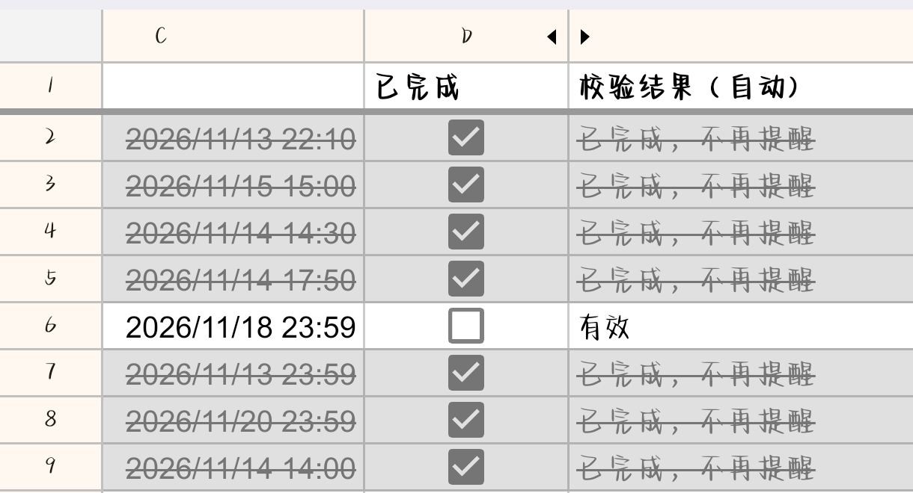

# Memorandum-googlesheets-zero-token-always-on

**基于 Google Sheets + Google Apps Script 的、不依赖个人 AI 服务的个人邮件备忘录。**

**零 AI token 消耗 · 无需 AI API Key · 无需 AI 订阅 · 电脑关机也能运行**

在手机上编辑 Google 表格，由 Google 云端脚本自动检查截止时间并发送邮件。所有提醒由确定的程序规则执行，部署完成后不需要 AI 持续参与。

> 零 AI token 消耗不等于无限资源。运行受 Google Apps Script 的邮件、执行时间及存储读写配额限制。

## 默认策略

- 每天北京时间 **09:00、14:20、20:20** 汇总未来不足 **48 小时**内到期的未完成事项。
- 每个事项在 **DDL 前 5 小时**单独提醒。
- 编辑表格后更新任务快照；后台每 **10 分钟**检查一次提醒计划。
- 事务左侧自动显示 DDL 的星期和 24 小时时间，例如 **周五 18:00**。
- 勾选完成后整行灰底并显示删除线，取消勾选后恢复。旧版用户替换代码后运行一次 `setup` 自动升级表格。

  

- 完成或删除后不再提醒；到点后的轮询等待约为 0～10 分钟，另有服务与投递延迟。

## 开始使用

1. 新建 Google 表格，打开 **扩展程序 → Apps Script**。
2. 复制 [`src/Code.gs`](src/Code.gs)，填写自己的收件邮箱，保存并运行 `setup` 完成授权。
3. 运行 `sendTestEmail` 验证邮件，在生成的工作表中填写事务、DDL 和完成状态。

部署无需 Node.js。Node.js 仅用于本地测试与发布前检查；不需要安装第三方 npm 包。

## 文档

- [中文完整说明与配置教程](README_zh.md)
- [Google 配额、费用边界及官方资料](docs/quotas.md)
- [发布到 GitHub 与脱敏说明](docs/publishing.md)
- [贡献说明](CONTRIBUTING.md)

## 开发检查

```bash
npm run check
```

包括离线模拟测试及基础敏感信息检查；不会发送真实邮件。云端触发和真实投递需要部署后验证。

## 数据与许可

仓库只含脱敏程序和示例，不包含私人任务、邮箱、表格标识、账号凭据或运行日志。每个使用者在自己的 Google 账号下安装和授权。

当前尚未指定开源许可证，公开发布前可由维护者选择并添加 `LICENSE`；公开仓库不自动授予开源许可。
