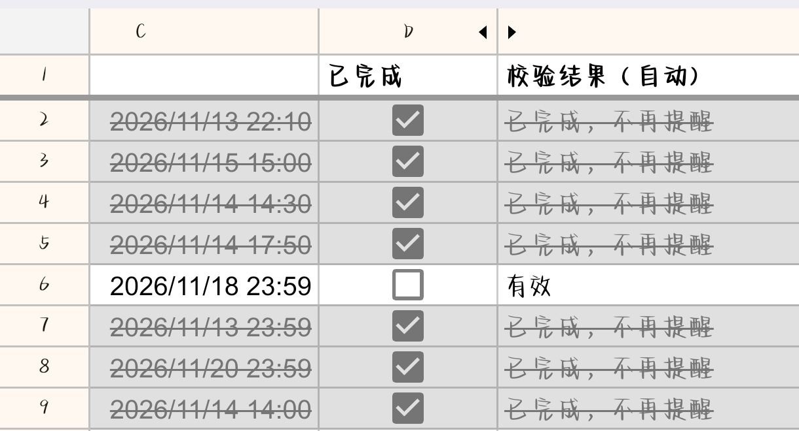

# Memorandum

基于 **Google Sheets + Google Apps Script** 的、不依赖个人 AI 服务的个人邮件备忘录。在手机上维护事项和截止时间，由 Google 云端脚本自动发送提醒，无需个人电脑持续开机。

**不消耗 AI token，不需要 AI API Key，不依赖个人 AI 订阅或聊天窗口。** 配置完成后，Google 云端脚本独立检查截止时间并发送邮件。AI 可以辅助开发，但不参与运行。

这并不意味着无限资源：Google 的发信、触发器运行时间和属性读写仍有额度。详见 [Google 配额与运行成本](docs/quotas.md)。

## 功能

- 使用 Google 表格新增、修改、完成或删除事项。
- 编辑同步到云端后，读取任务并保存持久化快照。
- 每天三次发送临近截止事项的汇总邮件。
- 在单个事项截止前五小时发送独立提醒。
- 每十分钟检查提醒计划，不重复读取任务表格。
- 校验截止时间，生成任务编号，记录已发送的单项提醒。
- 支持独立配置收件邮箱，以及查询运行耗时估算和剩余发信额度。

## 工作原理

```text
手机 / 浏览器编辑表格
          │
          ▼
编辑或结构变化触发器
          │ 读取任务并校验
          ▼
Script Properties 保存任务快照和发送记录
          │
          ▼
每 10 分钟检查时间
          │ 到达提醒时间
          ▼
MailApp 发送邮件 → 保存发送结果
```

表格是任务的维护入口；持久化属性保存后台实际使用的数据。汇总和单项提醒均从已保存的快照生成，不会在每次定时检查时重新读取表格。

## 默认提醒规则

所有时间统一采用 **Asia/Shanghai（北京时间，UTC+8）**。

| 类型 | 目标时间 | 范围与内容 |
| --- | --- | --- |
| 每日汇总 | 09:00、14:20、20:20 | 距离截止时间不足 48 小时且尚未过期的未完成事项，按截止时间排序，列出事务及 DDL |
| 单项提醒 | 每个事项 DDL 前 5 小时 | 单独一封邮件，包含该事项及 DDL |
| 后台检查 | 每 10 分钟 | 检查保存的提醒计划，处理已经到点的邮件 |

具体行为：

- 汇总筛选条件为 `0 < DDL - 实际检查时间 < 48 小时`。恰好剩余 48 小时的事项暂不纳入；没有符合条件的事项时仍发送“暂无”邮件。
- 同一事项可以连续进入多封汇总。汇总与单项提醒独立，时间重合时分别发送。
- 新增或改期的事项如果已不足 5 小时、但尚未过期，下次检查补发单项提醒。夜间同样执行。
- 已完成、已删除、已过期或校验不通过的事项不参与后续提醒。编辑或删除须先成功同步到后台快照。
- 同一任务编号及同一 DDL 的单项提醒会保存发送记录。仅修改名称不会重发；改成新的 DDL 会重新安排；改回已提醒过的同一 DDL 不再重发。复制行生成新任务编号，视为另一任务。
- 首次启用从下一个汇总时间开始，不补发当天此前的汇总。
- 后台延迟跨过汇总时间时补发一次，以实际检查时的数据生成内容；跨过多个汇总时间也只补发一次，随后恢复未来计划。已过期事项不补发单项提醒。

### 时间精度

提醒时间是目标时间。默认每十分钟检查一次，仅考虑轮询，等待约为 0～10 分钟；Google 调度、服务调用和邮件投递可能带来额外延迟。

后台遇到同步锁时会跳过本次检查，执行失败也可能使提醒进一步延后。系统不提供严格的最大延迟保证，不适合依赖秒级送达的场景。

## 文件结构

```text
memorandum/
├── README.md                  # GitHub 首页
├── README_zh.md               # 中文完整文档
├── src/
│   ├── Code.gs                # 已脱敏的 Apps Script 程序
│   └── appsscript.json        # V8 与北京时间配置
├── tests/test.cjs             # 离线模拟测试
├── scripts/check-privacy.cjs  # 发布前敏感信息检查
├── docs/
│   ├── quotas.md             # Google 配额与官方资料
│   └── publishing.md         # GitHub 发布与脱敏说明
├── .github/                  # CI 与问题模板
├── CONTRIBUTING.md
└── package.json
```

## 快速开始

### 1. 创建表格与脚本

1. 使用浏览器登录 Google 账号，新建一个专用 Google 表格。
2. 表格文件可命名为 `memorandum`，文件名不影响程序运行。
3. 在顶部菜单选择 **扩展程序 → Apps Script**。
4. 将 [`src/Code.gs`](src/Code.gs) 的完整代码粘贴到编辑器，替换默认代码。

### 2. 配置

在代码顶部调整配置。以下收件人是故意无法通过校验的占位符，部署时必须替换成实际邮箱：

```javascript
const CONFIG = {
  recipient: 'YOUR_EMAIL_HERE',
  sheetName: '我的备忘录',
  timezone: 'Asia/Shanghai',
  summaryTimes: ['09:00', '14:20', '20:20'],
  windowHours: 48,
  advanceHours: 5,
  checkMinutes: 10,
};
```

| 配置 | 含义 |
| --- | --- |
| `recipient` | 唯一收件邮箱，可以与安装脚本的 Google 账号不同 |
| `sheetName` | 表格底部的工作表标签名称，与顶部文件名不同 |
| `timezone` | 保持 `Asia/Shanghai`；当前日期解析和每日时间计算按北京时间实现 |
| `summaryTimes` | 每日汇总目标时间，须按时间先后顺序填写 |
| `windowHours` | 汇总纳入范围，默认不足 48 小时 |
| `advanceHours` | 单项提前提醒时长，默认 5 小时 |
| `checkMinutes` | 后台检查间隔，当前支持 5 或 10 分钟 |

在 Apps Script **项目设置**中也将时区设置为北京时间。初始化会将专用表格的时区设置为北京时间。

### 3. 初始化

1. 保存代码，在顶部函数下拉框选择 `setup`，点击 **运行**。
2. 完成 Google 对表格访问、邮件发送和触发器管理的授权。
3. 程序会创建配置指定的工作表、表头、完成复选框及三个触发器。
4. 在左侧 **触发器** 页面确认存在 `memoEdited`、`memoChanged`、`tick`，其中 `tick` 每十分钟执行。
5. 选择 `sendTestEmail` 并运行，确认收件箱或垃圾邮件中收到测试邮件。

不需要点击“部署”。初始化成功即启用提醒，此后关闭浏览器或个人电脑不影响云端执行。

仅由一个 Google 账号初始化同一个项目，避免不同账号创建重复触发器。原版五列表头会自动升级为六列；其他不匹配的表头仍会报错，不会覆盖原工作表。

## 日常使用

打开配置指定的工作表，每行填写一件事：

| 时间（自动） | 事务 | DDL | 已完成 |
| --- | --- | --- | --- |
| 周日 18:00 | 提交材料 | 2027/06/20 18:00 | 不勾选 |

- DDL 需要完整的 **年、月、日、小时、分钟**，推荐 `YYYY/MM/DD HH:mm`，采用 24 小时制。
- “时间（自动）”位于事务左边，由脚本根据 DDL 生成，例如 `周五 18:00`，采用北京时间和 24 小时制，不需要手填；修改 DDL 后自动更新，清空或无效日期时自动清空。
- 完成后勾选“已完成”，整行立即显示灰色填充、灰字和删除线；取消勾选后恢复原样式。也可以删除整行。

  

- “任务编号（自动）”由程序维护并默认隐藏，请勿手工修改。
- “校验结果（自动）”显示有效状态或需要修正的内容。
- 手机离线编辑要等联网同步到 Google 后，才能触发后台更新。

日期、事务、完成状态应直接填写，不使用公式。公式自动变化、其他脚本或 API 写入不会可靠触发本项目的同步流程，需要手动运行 `syncNow` 更新快照。

## 管理功能

在顶部函数下拉框选择函数，点击运行即可：

| 函数 | 用途 |
| --- | --- |
| `setup` | 初始化或重建当前账号的三个触发器，保留任务及已发送记录 |
| `sendTestEmail` | 手动发送一封配置测试邮件 |
| `syncNow` | 手动重新读取表格并更新任务快照 |
| `checkRuntime` | 查看本项目耗时估算及剩余邮件收件人人次，不发送邮件 |
| `stopReminders` | 删除当前账号的本项目触发器，暂停自动提醒；表格和保存的数据保留 |

切换函数下拉框不会改变后台任务。运行 `checkRuntime` 或 `sendTestEmail` 后，无需再次运行 `setup`。

### 修改配置

- **更换收件邮箱：**修改 `recipient` 并保存即可，建议运行 `sendTestEmail` 验证。不会向旧地址继续发送新邮件，也不会补发新地址此前未收到的邮件。
- **修改检查间隔：**修改 `checkMinutes`，保存并运行 `setup`，才会替换已经存在的定时触发器。
- **修改汇总窗口或提前时长：**修改后保存并运行 `syncNow`，让后台重新判断下一次需要处理的时间。
- **修改每日汇总时刻：**保存并运行 `syncNow`；已保存的下一次汇总可能仍沿用原时间，该次处理后会按新配置计算后续时间。
- **恢复暂停的提醒：**运行 `setup`。

升级已有项目时，请保留线上实际使用的 `recipient` 和 `sheetName`。本地文件的配置不一定与线上一致。

本次增加自动时间列和完成样式：用新版 `Code.gs` 替换原代码，保存后运行一次 `setup`。程序在原五列表格最左侧自动插入“时间（自动）”，补全已有事项的星期与时间，并配置完成样式。原事务、DDL、完成勾选、任务编号和已发送提醒记录保留。重复运行不会重复插列或重置勾选。新版 A～F 列依次为自动时间、事务、DDL、已完成、隐藏任务编号、校验结果；请继续在 C 列输入完整 DDL。

## 运行成本与配额

本项目运行不调用 AI 服务，不消耗 AI token，也无需自行租用服务器。运行仍受 Google Apps Script 的账号权限及服务配额限制。

每十分钟检查一次，每天约 144 次；每五分钟检查一次，每天约 288 次。没有到下次提醒时间时，后台只读取保存的时间值并快速退出。未变化的编号和校验结果不重复写回，后台锁冲突不等待。

`checkRuntime` 统计最近约 24～25 小时的已记录检查与同步次数、主体耗时、平均及最长耗时、失败次数，并查询当前邮件剩余额度。

这些耗时是**程序内估算**，不是 Google 官方剩余运行额度：不包括统计逻辑自身、其他项目和未记录操作；手动运行 `tick` 也计入；统计保存失败可能缺样。请结合 Apps Script 左侧 **执行记录** 核对。

不保证永不超额：频繁编辑、任务量、服务响应耗时及同账号其他脚本都会影响使用量。常用额度及查询方式见 [配额文档](docs/quotas.md)。最新上限以 [Google 官方配额说明](https://developers.google.com/apps-script/guides/services/quotas) 为准。

## 限制与排查

| 现象 | 检查方法 |
| --- | --- |
| 收不到邮件 | 检查 `recipient`、垃圾邮件、Google 授权、执行记录及发信剩余额度 |
| 改表后未更新 | 检查 `memoEdited` / `memoChanged` 是否执行成功，修复后运行 `syncNow` |
| 校验结果报错 | 检查完整日期时间、事务名称和完成状态，移除公式 |
| 改了间隔仍按旧频率执行 | 保存后重新运行 `setup`，检查是否有重复触发器 |
| 删除或重命名工作表后失败 | 恢复配置对应名称，或正确调整配置，再运行 `syncNow` |
| 收到重复邮件 | 检查是否由多个账号初始化；确认是否属于汇总与单项提醒两种不同邮件 |

其他实现限制：

- 最多支持 500 条未完成任务，保存的单份任务状态限制为 150KB。
- 本项目按事件更新快照，没有额外的定时读表兜底。同步失败后继续使用的可能是旧快照，应检查错误并修复。
- 邮件发送和发送记录保存不是原子事务。若邮件发出后、记录写入前发生故障，后续可能重复发送，无法保证严格只发送一次。
- 已经发送的邮件无法通过勾选完成或改期撤回。
- 示例邮件标题按默认“48小时 / 前5小时”规则编写；修改对应时长时也应检查相关文字。

## 本地测试

安装 Node.js 后，在项目目录执行：

```bash
npm test
```

测试使用模拟的 Google 服务，不连接真实 Google 账号，也不会实际发送邮件。覆盖时间边界、北京时间解析、持久化、去重、改期、完成和删除同步、发信失败重试、锁冲突处理及耗时统计。

云端授权、真实触发器、服务耗时和邮件投递仍需要在部署账号中验证。

## 隐私与分享

- 本文档只使用示例邮箱和示例任务，不包含真实收件地址、表格 ID、私有链接、授权凭据或本机路径。
- 无需公开表格。任务快照和发送记录保存在 Google Apps Script 的 Script Properties 中，邮件由 Google 邮件服务发送到配置的收件地址。
- 发布代码前，将实际 `recipient` 替换为示例地址；不要提交个人任务、账号截图、含敏感内容的执行日志或凭据。
- 工作表编辑者和脚本项目访问权限应按实际使用需要配置。

## 官方资料

- [Google Apps Script 概述](https://developers.google.com/apps-script/overview)
- [绑定到表格的脚本](https://developers.google.com/apps-script/guides/bound)
- [可安装触发器](https://developers.google.com/apps-script/guides/triggers/installable)
- [定时触发器](https://developers.google.com/apps-script/reference/script/clock-trigger-builder)
- [MailApp 邮件服务](https://developers.google.com/apps-script/reference/mail/mail-app)
- [服务配额](https://developers.google.com/apps-script/guides/services/quotas)

## 发布与许可

参见 [发布指南](docs/publishing.md)。本地代码包不包含任何 Google 账号授权、表格数据或已安装的触发器，其他使用者需在自己的账号中配置。

当前尚未指定开源许可证，维护者可在公开发布前选择并添加 `LICENSE`。仓库公开可见不等同于已授予开源使用许可。
